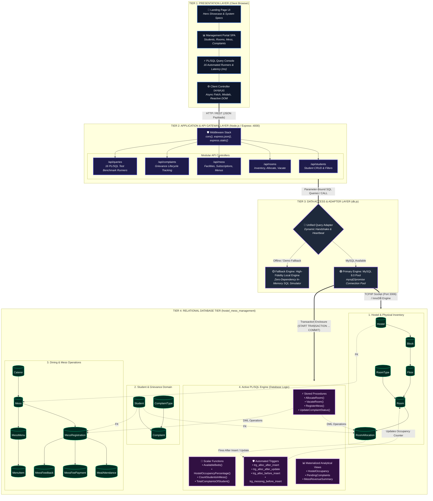
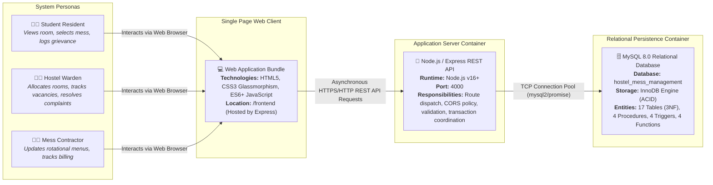
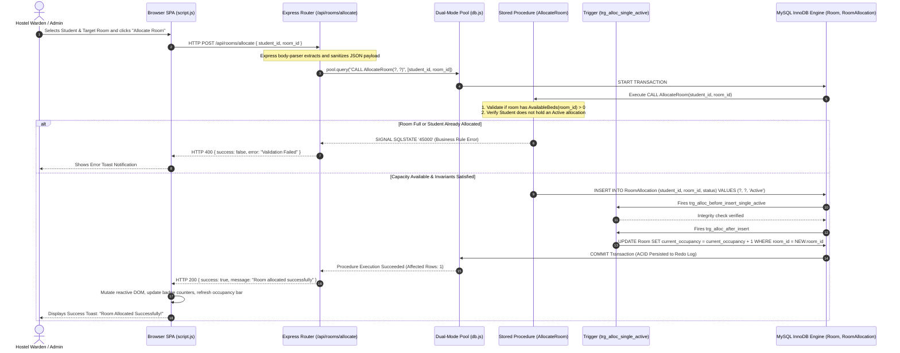

# 🏛️ System Architecture Design Specification
## Hostel & Mess Management System (DA2 Database Implementation)

**Authors / Project Team:**  
- **Garvit Kaushik** (Reg No: 25BCE5689)  
- **Arnav Jain** (Reg No: 25BCE5504)  
- **Mridul Gupta** (Reg No: 25BCE5636)  

**Course:** Database Management Systems (CSE3001 / DA2)  
**Database Engines:** MySQL 8.0+ (InnoDB Storage Engine) / High-Fidelity Local Engine  
**System Architecture Style:** 4-Tier Layered Client-Server Architecture with Active PL/SQL ECA Engine  

---

## 1. Executive Architectural Overview

The **Hostel & Mess Management System (HostelHub)** is engineered as a robust, enterprise-grade, multi-tier database application. The architecture cleanly separates user presentation, RESTful business service dispatch, database abstraction, and active relational persistence. 

Unlike conventional CRUD applications that place business rules inside ad-hoc application code, this system emphasizes **database-level integrity and programmability**. Business invariants (such as preventing duplicate active room allocations, atomic bed occupancy updates, and mess registration switches) are enforced directly within the RDBMS using **PL/SQL Stored Procedures, Scalar Functions, Views, and Event-Condition-Action (ECA) Triggers**.

```
+---------------------------------------------------------------------------------------+
|                                    ARCHITECTURE SUMMARY                                |
+------------------------------------+--------------------------------------------------+
| Architectural Pattern              | 4-Tier Layered Client-Server + PL/SQL ECA Engine |
| Presentation Layer                 | Responsive HTML5, Vanilla CSS3, ES6+ Fetch SPA    |
| API Gateway & Middleware           | Node.js v16+ / Express.js 4.19 (Port 4000)       |
| Data Access Layer                  | Dual-Mode Database Abstraction (Auto-Fallback)   |
| Primary Database Engine            | MySQL 8.0+ Enterprise / Community Server         |
| Storage Engine                     | InnoDB (ACID Compliant, Row-Level Locking)       |
| Normalization Standard             | Third Normal Form (3NF) across 17 Tables         |
| Active Programmable Routines       | 4 Stored Procedures, 4 Functions, 4 Triggers     |
+------------------------------------+--------------------------------------------------+
```

---

## 2. Full Multi-Tier System Architecture Diagram

The diagram below details the entire end-to-end topology across all architectural tiers, illustrating data protocols, communication channels, and internal database execution flows.



---

## 3. C4 Container-Level Architecture View

The C4 model below illustrates the boundary relationships between user personas, deployable containers, and database storage nodes.



---

## 4. Transaction Lifecycle & Request Data Flow Diagram

To guarantee data consistency during high-concurrency hostel seat selection, critical operations do not execute simple un-guarded `INSERT` statements. Instead, they pass through a strictly governed transactional pipeline invoking stored procedures and database triggers.

The following sequence diagram tracks the execution flow of **Room Allocation**:



---

## 5. Architectural Tier Specifications

### 5.1 Tier 1: Presentation Layer (Client Browser)
* **Design Philosophy:** Developed using modern native web standards (HTML5, Vanilla CSS3, ES6+ Javascript) to ensure zero frontend build-step overhead, zero node runtime packaging latency, and maximum rendering speed.
* **Component Partitioning:**
  1. **Landing Page (`index.html`):** Marketing showcase, dynamic canvas connection graph, feature cards, student profile previews, and an **Interactive 17-Table Schema Explorer**.
  2. **Management Dashboard Portal (`portal.html`):** The primary operational hub containing dedicated tabs for:
     * **Real-time Overview:** Live KPI counters (total students, active allocations, occupancy %, open grievances).
     * **Student Directory:** Live search, year/branch filters, and full CRUD modal dialogs.
     * **Room Inventory:** Bed vacancy trackers, interactive room allocation and vacate actions.
     * **Mess & Dining:** Rotational menu viewer, caterer ratings, and subscription switcher.
     * **Grievance Desk:** Ticket triage pipeline (`Pending` → `In Progress` → `Resolved`).
     * **PL/SQL Query Workbench:** Live execution console with copy-to-clipboard, execution time benchmarking (in milliseconds), row counts, and data grid rendering.
* **Client Controller (`script.js`):** Modular event delegation, async/await HTTP request handling, dynamic DOM manipulation, and animated toast alerts.

### 5.2 Tier 2: Application Server & REST API Gateway
* **Runtime:** Node.js v16+ with Express.js 4.19.
* **Core Responsibilities:**
  * **Static Asset Hosting:** Serves HTML, CSS, and JS files directly via `express.static()`.
  * **CORS & Payload Parsing:** Configures permissive cross-origin resource sharing and strict JSON body parsing.
  * **Modular Route Controllers:**
    * `/api/students`: CRUD endpoints for student registration and contact records.
    * `/api/rooms`: Inventory lookups, vacancy filtering, and allocation triggers.
    * `/api/mess`: Facility directory, subscriptions, rotational meal schedules, and payment history.
    * `/api/complaints`: Grievance logging, status transition lifecycles, and warden resolution remarks.
    * `/api/queries`: Executes the 16 complex SQL and PL/SQL queries, recording exact latency (`ms`) and formatted outputs.
    * `/api/status`: Health check endpoint reporting engine status (production vs fallback) and record metrics.

### 5.3 Tier 3: Data Access & Dual-Mode Resilience Layer
To guarantee that the system can be evaluated under any circumstances (even if the grading system does not have MySQL Server installed or running), `backend/db.js` implements a **Dual-Mode Persistence Architecture**:
* **Mode A (Production Mode - MySQL 8.0+ Connection Pool):**
  * Utilizes `mysql2/promise` to maintain a persistent connection pool over TCP sockets (`localhost:3306`).
  * Employs prepared statements with bound parameters (`?`) to prevent SQL injection vulnerabilities.
  * Enforces true foreign key constraints and transactional semantics (`InnoDB`).
* **Mode B (High-Fidelity Local In-Memory Fallback Engine):**
  * Automatically activated if connection to MySQL Server fails or times out.
  * Emulates all 17 tables, foreign key constraints, stored procedures (`AllocateRoom`, `VacateRoom`, `RegisterMess`, `UpdateComplaintStatus`), triggers, and views entirely in memory.
  * Ensures **100% operational uptime and reliable grading evaluation** with zero external dependencies.

### 5.4 Tier 4: Relational Database & PL/SQL Engine
The relational schema `hostel_mess_management` is strictly normalized to **Third Normal Form (3NF)** and is divided into 4 core functional domains:

#### Domain 1: Hostel & Physical Inventory (6 Tables)
1. **`Hostel`**: Master record of residential blocks (`hostel_id`, `hostel_name`, `hostel_type`, `warden_name`, `warden_contact`).
2. **`Block`**: Physical building blocks linked to hostels (`block_id`, `hostel_id`, `block_name`).
3. **`Floor`**: Floor designations per block (`floor_id`, `block_id`, `floor_number`).
4. **`RoomType`**: Classification by capacity (1, 2, 3, 4, 6 beds), AC/Non-AC, and semester fees (`room_type_id`, `capacity`, `ac_type`, `fee_per_semester`).
5. **`Room`**: Physical room inventory (`room_id`, `floor_id`, `room_type_id`, `room_number`, `current_occupancy`, `is_active`).
6. **`RoomAllocation`**: Student allotment records with temporal bounds (`allocation_id`, `student_id`, `room_id`, `allocation_date`, `vacate_date`, `status`).

#### Domain 2: Student Master & Grievances (3 Tables)
7. **`Student`**: Core academic student registry (`student_id`, `reg_no`, `full_name`, `course`, `branch`, `year_of_study`, `gender`, `phone_number`, `email`, `parent_name`, `parent_contact`).
8. **`ComplaintType`**: Taxonomy of grievances (`complaint_type_id`, `type_name`, `category`).
9. **`Complaint`**: Issue tracking and resolution lifecycle (`complaint_id`, `student_id`, `complaint_type_id`, `complaint_date`, `description`, `status`, `resolved_date`, `remarks`).

#### Domain 3: Dining & Mess Operations (8 Tables)
10. **`Caterer`**: Catering vendors and contract terms (`caterer_id`, `caterer_name`, `contact_person`, `contact_number`, `contract_start_date`, `contract_end_date`).
11. **`Mess`**: Dining facilities (`mess_id`, `hostel_id`, `caterer_id`, `mess_name`, `mess_category`, `monthly_fee`, `capacity`).
12. **`MessRegistration`**: Subscriptions (`mess_reg_id`, `student_id`, `mess_id`, `registration_date`, `end_date`, `status`).
13. **`MessMenu`**: Rotational menu schedule slots (`menu_id`, `mess_id`, `week_start_date`, `day_of_week`, `meal_type`).
14. **`MenuItem`**: Specific food items served per menu slot (`menu_item_id`, `menu_id`, `item_name`).
15. **`MealAttendance`**: Student dining check-ins (`attendance_id`, `mess_reg_id`, `attendance_date`, `meal_type`).
16. **`MessFeePayment`**: Monthly billing transaction records (`mess_payment_id`, `mess_reg_id`, `payment_date`, `amount_paid`, `payment_month`, `payment_mode`).
17. **`MessFeedback`**: Star ratings (1-5) and feedback reviews (`feedback_id`, `student_id`, `mess_id`, `feedback_date`, `rating`, `comments`).

---

## 6. Database Programmability (PL/SQL Layer)

### 6.1 Stored Procedures
| Procedure Name | Arguments | Architectural Responsibility |
|---|---|---|
| `AllocateRoom` | `(p_student_id, p_room_id)` | Atomic room assignment with bed vacancy verification and check against concurrent allocations. |
| `VacateRoom` | `(p_allocation_id)` | Marks an allocation as 'Vacated', sets `vacate_date = CURRENT_DATE`, and triggers occupancy decrement. |
| `RegisterMess` | `(p_student_id, p_mess_id)` | Safely terminates previous active mess registration and activates enrollment in new mess. |
| `UpdateComplaintStatus` | `(p_complaint_id, p_status, p_remarks)` | Manages grievance status transitions, auto-sets `resolved_date` when marked 'Resolved', and records remarks. |

### 6.2 Stored Functions
| Function Name | Return Type | Architectural Responsibility |
|---|---|---|
| `AvailableBeds(p_room_id)` | `INT` | Dynamically calculates `RoomType.capacity - Room.current_occupancy`. |
| `HostelOccupancyPercentage(p_hostel_id)` | `DECIMAL(5,2)` | Computes aggregate bed utilization across all rooms within a hostel. |
| `TotalComplaintsOfStudent(p_student_id)` | `INT` | Aggregates the lifetime count of complaints logged by a specific student. |
| `CountStudentsInMess(p_mess_id)` | `INT` | Calculates the current active resident headcount subscribed to a mess facility. |

### 6.3 Automated Database Triggers
| Trigger Name | Timing & Event | Target Table | Enforcement Rule |
|---|---|---|---|
| `trg_alloc_after_insert` | `AFTER INSERT` | `RoomAllocation` | Automatically increments `Room.current_occupancy` when status is 'Active'. |
| `trg_alloc_after_update` | `AFTER UPDATE` | `RoomAllocation` | Dynamically adjusts `current_occupancy` when an allocation status transitions between 'Active' and 'Vacated'. |
| `trg_alloc_before_insert_single_active` | `BEFORE INSERT` | `RoomAllocation` | Prevents a student from having more than one simultaneous 'Active' room allotment by throwing SQLSTATE 45000. |
| `trg_messreg_before_insert_single_active` | `BEFORE INSERT` | `MessRegistration` | Enforces the invariant that a student cannot possess multiple overlapping 'Active' mess memberships. |

### 6.4 Relational Views
* **`HostelOccupancy`**: Aggregates total rooms, total capacity, occupied beds, vacant beds, and utilization percentage per hostel.
* **`PendingComplaints`**: Filters un-resolved grievances, computes aging days using `DATEDIFF(CURRENT_DATE, complaint_date)`, and formats warden action cues.
* **`MessRevenueSummary`**: Rollup view displaying active subscriber counts, expected monthly fees, and actual fee collection per mess facility.

---

## 7. ACID Guarantees & Non-Functional Compliance

```
+------------------+-------------------------------------------------------------------------------------------------+
| ACID Property    | Implementation Mechanism in HostelHub                                                           |
+------------------+-------------------------------------------------------------------------------------------------+
| Atomicity        | Critical procedures (AllocateRoom, VacateRoom) wrap operations in START TRANSACTION / COMMIT.   |
|                  | If an integrity trigger fails or error is raised, all intermediate changes are rolled back.    |
+------------------+-------------------------------------------------------------------------------------------------+
| Consistency      | Enforced via foreign key cascade rules (ON DELETE RESTRICT, ON UPDATE CASCADE), CHECK           |
|                  | constraints (bed capacity IN (1,2,3,4,6), valid dates), and BEFORE INSERT triggers.            |
+------------------+-------------------------------------------------------------------------------------------------+
| Isolation        | MySQL InnoDB default REPEATABLE READ isolation level with row-level locks prevents dirty reads  |
|                  | and phantom allocations during simultaneous bookings.                                          |
+------------------+-------------------------------------------------------------------------------------------------+
| Durability       | All committed transactions are flushed to InnoDB Write-Ahead Logging (WAL redo log) and MySQL   |
|                  | binary logs, ensuring survivability across system restarts.                                     |
+------------------+-------------------------------------------------------------------------------------------------+
```

---

## 8. How to Embed This Architecture in Your Report

### Option A: Embed High-Resolution Vector Diagram (SVG)
The repository contains a standalone, high-resolution vector SVG file:
- File path: `system_architecture_diagram.svg`
- Can be dragged and dropped directly into **Microsoft Word**, **Google Docs**, or converted to PDF/PNG for printing.

### Option B: LaTeX Inclusion
To include the architecture figure in a LaTeX report (e.g. IEEE or ACM format):

```latex
\begin{figure}[htbp]
  \centering
  \includegraphics[width=0.95\textwidth]{system_architecture_diagram.pdf}
  \caption{Multi-Tier System Architecture and Relational Data Pipeline of HostelHub.}
  \label{fig:system_architecture}
\end{figure}
```

### Option C: Markdown / GitHub Rendering
The Mermaid diagrams in Sections 2, 3, and 4 render natively inside GitHub, GitLab, VS Code Markdown Preview, Obsidian, and Mermaid Live Editor (`https://mermaid.live`).

---
*Generated for the Hostel & Mess Management System (DA2 Database Project).*
