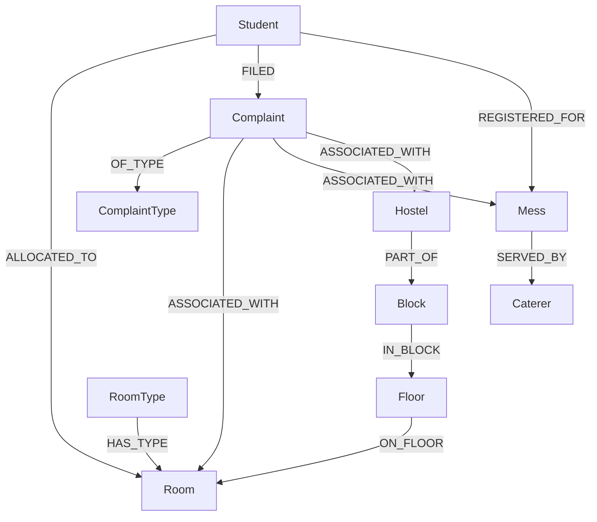

# 🌐 HOSTEL INTELLIGENCE WITH NEO4J — IMPLEMENTATION REPORT
**Course:** Database Management Systems (DA2 Coursework)  
**Project:** Hostel & Mess Management System (Extended Hybrid Architecture)  
**Authors:** Garvit Kaushik (25BCE5689), Arnav Jain (25BCE5504), Mridul Gupta (25BCE5636)  
**Primary Database:** MySQL 8.0+ (ACID Transactional Source of Truth)  
**Graph Database:** Neo4j 5.x / 4.x (Graph Intelligence & Network Analytics)  
**Application Backend:** Node.js, Express, `mysql2`, `neo4j-driver` (v6.2.0)  
**Frontend Visualization:** Vanilla HTML5, Neo-Brutalist CSS, Cytoscape.js v3.30.0  

---

## 1. Executive Summary & Problem Statement

### 1.1 The Relational Challenge in Campus Operations
Campus residential and dining infrastructures are fundamentally networked systems. Traditional Relational Database Management Systems (RDBMS) such as MySQL excel at transactional integrity, structured records, ACID guarantees, and tabular rollups (e.g., billing, room allocation counters, meal attendance check-ins). However, as queries begin to explore multi-hop connections—such as:
- *"Who are this student's current roommates across multi-tier block and floor hierarchies?"*
- *"Which students shared living quarters during overlapping historical academic terms?"*
- *"Which specific facilities (rooms, mess halls, hostel blocks) accumulate recurring grievances across multiple complaint categories?"*
- *"How do caterer food supply contracts propagate through mess subscriptions to student dining feedback and complaints?"*

In MySQL, answering these recursive and relationship-dense questions requires deep, multi-table joins (`JOIN ... JOIN ... JOIN`) across 5 to 7 tables (`Student`, `RoomAllocation`, `Room`, `Floor`, `Block`, `Hostel`, `Complaint`, `Mess`, `Caterer`). As data scales, relational joins incur substantial computational overhead, query plan complexity, and brittle foreign key cascades.

### 1.2 The Hybrid Graph-Relational Architecture
To solve this without sacrificing ACID compliance or replacing proven transactional workflows, this project introduces a **Hybrid Dual-Database Architecture**:
1. **MySQL remains the authoritative, single source of truth** for all transactions (room allocations, vacancy mutations, complaint filing, fee payments, and mess subscriptions).
2. **Neo4j operates as an operational Graph Intelligence Engine**, projecting entities as Nodes and associations as Edges using **Index-Free Adjacency** for millisecond-latency traversal, roommate exploration, grievance hotspot ranking, and interactive network visualization.

---

## 2. System Architecture & Data Flow

### 2.1 Component Interaction Diagram

```
+-----------------------------------------------------------------------------------+
|                           Client Web Browser (Frontend)                           |
|       Tabs: Dashboard | Students | Rooms | Mess | Grievances | Query Console       |
|            + NEW: Hostel Intelligence [Neo4j] (6 Integrated Sub-Panels)            |
+-----------------------------------------------------------------------------------+
                                       |
                                       | HTTP REST Requests (JSON)
                                       v
+-----------------------------------------------------------------------------------+
|                           Node.js / Express Backend Server                        |
|                                (Port 4000)                                        |
|   /api/students   /api/rooms   /api/mess   /api/complaints   /api/queries         |
|   + NEW: /api/graph (Health, Roommates, History, Hotspots, Vacancy, Mess, Graph)  |
+-----------------------------------------------------------------------------------+
                           |                               |
       SQL CRUD & Stored   |                               |  Parameterized Cypher
       Procedures (mysql2) |                               |  Sessions (neo4j-driver)
                           v                               v
        +-----------------------------------+     +-----------------------------------+
        |       MySQL Database (8.0+)       |     |          Neo4j Graph DB           |
        |  17 Relational Tables + Triggers  |     |   10 Labeled Nodes + 11 Rel Types |
        |  AUTHORITATIVE TRANSACTION SOURCE |     |   GRAPH INTELLIGENCE PROJECTION   |
        +-----------------------------------+     +-----------------------------------+
                           |                               ^
                           +-------- ETL Pipeline ---------+
                               (scripts/sync-neo4j.js)
                           Idempotent `MERGE` Synchronization
```

### 2.2 Operational Separation of Concerns
| Operational Vector | MySQL 8.0+ Responsibility | Neo4j Responsibility |
|---|---|---|
| **Primary Role** | ACID Source of Truth, System of Record | Graph Analytics, Multi-hop Relationship Traversal |
| **Allocations** | Authoritative checks via `AvailableBeds()`, `AllocateRoom` procedure | Traverses hierarchical filters to discover candidate rooms |
| **Grievance Filing** | Foreign key persistence (`room_id`, `mess_id`, `hostel_id`) | Hotspot aggregation, co-occurrence clustering |
| **Roommate Queries** | Temporal date range scans with self-joins | Direct O(k) neighbor traversal via `[:ALLOCATED_TO]` |
| **Write Isolation** | Row-level locking, foreign key integrity | Graph schema uniqueness constraints (`MERGE` idempotency) |
| **Failure Mode** | Critical system failure if down | **Graceful degradation**: System remains 100% operational in CRUD |

---

## 3. Neo4j Property Graph Data Model

### 3.1 Node Labels & Schema Definition



#### Detailed Node Specifications:
1. **`(:Student)`**
   - **Unique Identifier:** `student_id` (Integer)
   - **Properties:** `student_id`, `reg_no` (Indexed), `name`, `branch`, `year_of_study`, `email`, `contact_no`
2. **`(:Room)`**
   - **Unique Identifier:** `room_id` (Integer)
   - **Properties:** `room_id`, `room_number` (String), `capacity` (Integer), `current_occupancy` (Integer), `is_active` (Boolean)
3. **`(:Hostel)`**
   - **Unique Identifier:** `hostel_id` (Integer)
   - **Properties:** `hostel_id`, `hostel_name` (String), `type` ('Boys' / 'Girls'), `warden_name`
4. **`(:Block)`**
   - **Unique Identifier:** `block_id` (Integer)
   - **Properties:** `block_id`, `block_name` (String)
5. **`(:Floor)`**
   - **Unique Identifier:** `floor_id` (Integer)
   - **Properties:** `floor_id`, `floor_number` (Integer)
6. **`(:RoomType)`**
   - **Unique Identifier:** `room_type_id` (Integer)
   - **Properties:** `room_type_id`, `type_name` (e.g., 'Double AC', 'Four Bed Non-AC'), `capacity`, `is_ac`
7. **`(:Complaint)`**
   - **Unique Identifier:** `complaint_id` (Integer)
   - **Properties:** `complaint_id`, `title`, `description`, `status` ('Pending', 'In Progress', 'Resolved'), `filing_date` (ISO Date), `warden_remarks`
8. **`(:ComplaintType)`**
   - **Unique Identifier:** `type_id` (Integer)
   - **Properties:** `type_id`, `type_name` (e.g., 'Electrical', 'Plumbing', 'Food Quality', 'Cleanliness'), `category` ('Hostel' / 'Mess')
9. **`(:Mess)`**
   - **Unique Identifier:** `mess_id` (Integer)
   - **Properties:** `mess_id`, `mess_name` (String), `type` ('Veg', 'Non-Veg', 'Special'), `capacity` (Integer)
10. **`(:Caterer)`**
    - **Unique Identifier:** `caterer_id` (Integer)
    - **Properties:** `caterer_id`, `caterer_name` (String), `contact_person`, `contact_no`

### 3.2 Relationship Edge Specifications

| Relationship Type | Source Node | Target Node | Key Edge Properties | Description & Semantics |
|---|---|---|---|---|
| `ALLOCATED_TO` | `Student` | `Room` | `allocation_id`, `status` ('Active'/'Vacated'), `start_date`, `end_date` | Active or historical residency allotment |
| `ON_FLOOR` | `Room` | `Floor` | — | Physical floor location |
| `IN_BLOCK` | `Floor` | `Block` | — | Block container |
| `PART_OF` | `Block` | `Hostel` | — | Hostel residential complex hierarchy |
| `HAS_TYPE` | `Room` | `RoomType` | — | Architectural room type, AC status, and base capacity |
| `FILED` | `Student` | `Complaint` | `filing_date` | Complainant origin of grievance |
| `OF_TYPE` | `Complaint` | `ComplaintType` | — | Grievance categorization |
| `ASSOCIATED_WITH` | `Complaint` | `Room` \| `Mess` \| `Hostel` | `facility_type` ('Room'/'Mess'/'Hostel') | **Explicit, validated facility link** |
| `REGISTERED_FOR` | `Student` | `Mess` | `reg_id`, `status` ('Active'/'Cancelled'), `start_date`, `end_date` | Dining subscription allotment |
| `SERVED_BY` | `Mess` | `Caterer` | `contract_start`, `contract_end` | Vendor catering supply contract |

### 3.3 Uniqueness Constraints & Schema Invariants
All node types enforce strict uniqueness on their primary keys in Neo4j (compatible with Neo4j 4.4, 5.x, and AuraDB):
```cypher
CREATE CONSTRAINT student_id_unique IF NOT EXISTS FOR (s:Student) REQUIRE s.student_id IS UNIQUE;
CREATE CONSTRAINT room_id_unique IF NOT EXISTS FOR (r:Room) REQUIRE r.room_id IS UNIQUE;
CREATE CONSTRAINT hostel_id_unique IF NOT EXISTS FOR (h:Hostel) REQUIRE h.hostel_id IS UNIQUE;
CREATE CONSTRAINT block_id_unique IF NOT EXISTS FOR (b:Block) REQUIRE b.block_id IS UNIQUE;
CREATE CONSTRAINT floor_id_unique IF NOT EXISTS FOR (f:Floor) REQUIRE f.floor_id IS UNIQUE;
CREATE CONSTRAINT room_type_id_unique IF NOT EXISTS FOR (rt:RoomType) REQUIRE rt.room_type_id IS UNIQUE;
CREATE CONSTRAINT complaint_id_unique IF NOT EXISTS FOR (c:Complaint) REQUIRE c.complaint_id IS UNIQUE;
CREATE CONSTRAINT complaint_type_id_unique IF NOT EXISTS FOR (ct:ComplaintType) REQUIRE ct.type_id IS UNIQUE;
CREATE CONSTRAINT mess_id_unique IF NOT EXISTS FOR (m:Mess) REQUIRE m.mess_id IS UNIQUE;
CREATE CONSTRAINT caterer_id_unique IF NOT EXISTS FOR (cat:Caterer) REQUIRE cat.caterer_id IS UNIQUE;
```

---

## 4. Idempotent ETL Pipeline (`sync-neo4j.js`)

### 4.1 Truthful Grievance Attribution Rule
A critical architectural principle established in this project is **Truthful Grievance Attribution**:
> *A complaint filed by a student must NEVER be automatically assumed to belong to that student's currently allocated room or mess.*

Students can file general campus grievances, Wi-Fi issues in the common room, or mess complaints regarding dining halls they do not currently subscribe to. To prevent falsifying facility hotspots, we introduced a backward-compatible migration:
- `database/migration_neo4j_facility_complaint.sql`:
  ```sql
  ALTER TABLE Complaint 
    ADD COLUMN room_id INT NULL,
    ADD COLUMN mess_id INT NULL,
    ADD COLUMN hostel_id INT NULL,
    ADD CONSTRAINT fk_complaint_room FOREIGN KEY (room_id) REFERENCES Room(room_id) ON DELETE SET NULL,
    ADD CONSTRAINT fk_complaint_mess FOREIGN KEY (mess_id) REFERENCES Mess(mess_id) ON DELETE SET NULL,
    ADD CONSTRAINT fk_complaint_hostel FOREIGN KEY (hostel_id) REFERENCES Hostel(hostel_id) ON DELETE SET NULL;
  ```
- **Application Invariant:** A complaint links to at most **one** explicit facility (`room_id`, `mess_id`, or `hostel_id`). If all three are `NULL`, the complaint is classified as a **General Campus Grievance (Unlinked)** and excluded from room/mess hotspot counts, maintaining statistical integrity.

### 4.2 Idempotency & Reconciliation Design
The synchronization script (`backend/scripts/sync-neo4j.js`) ensures that running the synchronization multiple times:
1. **Never generates duplicate nodes:** Employs `MERGE` against uniqueness constraints.
2. **Updates modified properties:** Uses `ON MATCH SET` to refresh statuses, occupancies, and contact numbers.
3. **Reconciles modified relationships:** When a student vacates or changes rooms, the script executes:
   ```cypher
   MATCH (s:Student {student_id: $studentId})-[old:ALLOCATED_TO]->()
   DELETE old
   WITH s
   MATCH (r:Room {room_id: $roomId})
   MERGE (s)-[rel:ALLOCATED_TO {allocation_id: $allocId}]->(r)
   SET rel.status = $status, rel.start_date = $startDate, rel.end_date = $endDate
   ```
4. **Reconciles facility grievance mutations:** Clears any existing `[:ASSOCIATED_WITH]` edges on a complaint before creating the updated facility association, preventing dangling edges if a grievance is reassigned.

---

## 5. Core Graph Intelligence Features & Cypher Queries

### 5.1 Feature 1: Roommate Relationship Explorer
- **Objective:** Identify all co-residents currently sharing the same physical living quarters with a given student, including room specifications, floor, block, and hostel hierarchy.
- **Why Graph is Superior:** In SQL, this requires a self-join on `RoomAllocation` joined to `Room`, `Student`, `Block`, and `Hostel`. In Neo4j, it is a single 2-hop symmetric traversal `(s)-[:ALLOCATED_TO]->(r)<-[:ALLOCATED_TO]-(roommate)`.
- **Cypher Query:**
```cypher
MATCH (s:Student {student_id: $studentId})-[a1:ALLOCATED_TO {status: 'Active'}]->(r:Room)
MATCH (r)-[:ON_FLOOR]->(f:Floor)-[:IN_BLOCK]->(b:Block)-[:PART_OF]->(h:Hostel)
MATCH (r)-[:HAS_TYPE]->(rt:RoomType)
OPTIONAL MATCH (roommate:Student)-[a2:ALLOCATED_TO {status: 'Active'}]->(r)
WHERE roommate.student_id <> s.student_id
RETURN s.student_id AS searchedId,
       s.name AS studentName,
       s.reg_no AS regNo,
       r.room_id AS roomId,
       r.room_number AS roomNumber,
       rt.type_name AS roomType,
       h.hostel_name AS hostelName,
       b.block_name AS blockName,
       f.floor_number AS floorNumber,
       collect(DISTINCT {
         student_id: roommate.student_id,
         name: roommate.name,
         reg_no: roommate.reg_no,
         branch: roommate.branch,
         year: roommate.year_of_study,
         contact: roommate.contact_no
       }) AS roommates;
```
- **Expected Output Shape:**
```json
{
  "student": { "id": 1, "name": "Garvit Kaushik", "reg_no": "25BCE5689" },
  "room": { "room_number": "A-101", "room_type": "Double AC", "hostel": "Dr. Sarvepalli Radhakrishnan Hostel", "block": "A-Block", "floor": 1 },
  "roommates": [
    { "student_id": 2, "name": "Arnav Jain", "reg_no": "25BCE5504", "branch": "Computer Science", "year": 2 }
  ]
}
```

### 5.2 Feature 2: Historical Allocation & Roommate Overlap Analysis
- **Objective:** Discover students who shared living quarters with the subject student in past terms, strictly enforcing temporal interval overlap:
  $$\text{Overlap Condition: } \max(start_1, start_2) \le \min(end_1, end_2)$$
- **Cypher Query:**
```cypher
MATCH (s:Student {student_id: $studentId})-[a1:ALLOCATED_TO]->(r:Room)
MATCH (pastMate:Student)-[a2:ALLOCATED_TO]->(r)
WHERE pastMate.student_id <> s.student_id
  AND a1.start_date <= coalesce(a2.end_date, '9999-12-31')
  AND a2.start_date <= coalesce(a1.end_date, '9999-12-31')
MATCH (r)-[:ON_FLOOR]->()-[:IN_BLOCK]->()-[:PART_OF]->(h:Hostel)
RETURN pastMate.student_id AS pastMateId,
       pastMate.name AS pastMateName,
       pastMate.reg_no AS pastMateRegNo,
       r.room_number AS roomNumber,
       h.hostel_name AS hostelName,
       a1.start_date AS myStart,
       a1.end_date AS myEnd,
       a2.start_date AS mateStart,
       a2.end_date AS mateEnd
ORDER BY a1.start_date DESC;
```
- **Academic Limitation & Handling:** In current college sample datasets, historical records have limited temporal span. The system accurately surfaces historical peers when data exists, while displaying an informative empty state when no historical overlaps are recorded, rather than falsely displaying peers with non-overlapping leases.

### 5.3 Feature 3: Grievance Hotspot Ranking & Facility Clustering
- **Objective:** Identify facilities with the highest volume of recurring or unresolved complaints, grouped by facility type (Room, Mess, Hostel), while clearly distinguishing linked vs. unlinked general campus complaints.
- **Cypher Query:**
```cypher
MATCH (c:Complaint)-[:ASSOCIATED_WITH]->(facility)
WHERE ($status IS NULL OR c.status = $status)
MATCH (c)-[:OF_TYPE]->(ct:ComplaintType)
WHERE ($category IS NULL OR ct.category = $category)
WITH facility, labels(facility)[0] AS facilityType, count(DISTINCT c) AS grievanceCount,
     collect(c) AS complaints
RETURN facilityType,
       coalesce(facility.room_number, facility.mess_name, facility.hostel_name) AS facilityIdentifier,
       coalesce(facility.room_id, facility.mess_id, facility.hostel_id) AS facilityId,
       grievanceCount,
       [comp IN complaints | {
         id: comp.complaint_id,
         title: comp.title,
         status: comp.status,
         date: comp.filing_date
       }] AS complaintList
ORDER BY grievanceCount DESC
LIMIT $limit;
```
- **Expected Output Shape:**
```json
{
  "hotspots": [
    {
      "facilityType": "Room",
      "facilityName": "Room A-101",
      "openCount": 2,
      "totalCount": 2,
      "categories": ["Plumbing", "Electrical"]
    },
    {
      "facilityType": "Mess",
      "facilityName": "Zenith Multi-Cuisine Mess",
      "openCount": 1,
      "totalCount": 1,
      "categories": ["Food Quality"]
    }
  ],
  "unlinkedCount": 2
}
```

### 5.4 Feature 4: Smart Room & Vacancy Finder (Hybrid Validation)
- **Objective:** Rapidly discover candidate rooms using topological graph filters (Hostel $\to$ Block $\to$ Floor $\to$ RoomType $\to$ Room), while validating bed vacancy against MySQL before rendering.
- **Critical Allocation Rule:** Neo4j discovers structural candidates; MySQL validates bed vacancy via `capacity - current_occupancy > 0` and executes transactional allocations via `CALL AllocateRoom(studentId, roomId)`.
- **Cypher Query:**
```cypher
MATCH (r:Room)-[:ON_FLOOR]->(f:Floor)-[:IN_BLOCK]->(b:Block)-[:PART_OF]->(h:Hostel)
MATCH (r)-[:HAS_TYPE]->(rt:RoomType)
WHERE ($hostelId IS NULL OR h.hostel_id = $hostelId)
  AND ($blockId IS NULL OR b.block_id = $blockId)
  AND ($roomTypeId IS NULL OR rt.room_type_id = $roomTypeId)
  AND ($isAc IS NULL OR rt.is_ac = $isAc)
OPTIONAL MATCH (s:Student)-[alloc:ALLOCATED_TO {status: 'Active'}]->(r)
WITH r, f, b, h, rt, count(s) AS activeOccupants
WHERE activeOccupants < r.capacity
RETURN r.room_id AS roomId,
       r.room_number AS roomNumber,
       r.capacity AS capacity,
       activeOccupants,
       (r.capacity - activeOccupants) AS graphEstimatedAvailable,
       h.hostel_name AS hostelName,
       b.block_name AS blockName,
       f.floor_number AS floorNumber,
       rt.type_name AS typeName,
       rt.is_ac AS isAc
ORDER BY graphEstimatedAvailable DESC, r.room_number ASC;
```

### 5.5 Feature 5: Mess & Student Connection Explorer
- **Objective:** Reveal the tripartite operational network of a dining facility: active student subscriptions, catering contractor supply commitments, and explicitly linked food/hygiene complaints.
- **Cypher Query:**
```cypher
MATCH (m:Mess {mess_id: $messId})
OPTIONAL MATCH (m)-[:SERVED_BY]->(cat:Caterer)
OPTIONAL MATCH (s:Student)-[reg:REGISTERED_FOR {status: 'Active'}]->(m)
OPTIONAL MATCH (c:Complaint {status: 'Pending'})-[:ASSOCIATED_WITH]->(m)
OPTIONAL MATCH (c)-[:OF_TYPE]->(ct:ComplaintType)
RETURN m.mess_id AS messId,
       m.mess_name AS messName,
       m.type AS messType,
       m.capacity AS messCapacity,
       cat.caterer_id AS catererId,
       cat.caterer_name AS catererName,
       cat.contact_person AS catererContact,
       count(DISTINCT s) AS activeStudents,
       collect(DISTINCT { student_id: s.student_id, name: s.name, reg_no: s.reg_no, branch: s.branch }) AS studentList,
       count(DISTINCT c) AS pendingGrievances,
       collect(DISTINCT { id: c.complaint_id, title: c.title, category: ct.type_name }) AS complaints;
```

---

## 6. Interactive Network Visualization (Cytoscape.js)

### 6.1 Architecture & Offline Delivery
To guarantee uninterrupted execution during academic evaluations without internet or CDN dependency:
- The complete **Cytoscape.js v3.30.0** runtime was locally vendored into `frontend/assets/cytoscape.min.js` (373 KB).
- The graph visualization engine dynamically queries `GET /api/graph/explore?nodeLimit=50&category=All`.
- Nodes are mapped to a color-coded neo-brutalist visual palette with clear border weights and distinct shape keys:

| Node Type | Color Hex Code | Visual Node Shape | Rendered Label |
|---|---|---|---|
| **Student** | `#6366f1` (Indigo) | Ellipse | Student Name + Reg No |
| **Room** | `#10b981` (Emerald Green) | Round Rectangle | Room Number |
| **Hostel** | `#f59e0b` (Amber) | Cut-Rectangle | Hostel Name |
| **Complaint** | `#ef4444` (Crimson Red) | Diamond | Complaint Title + Status |
| **Mess** | `#ec4899` (Fuchsia Pink) | Hexagon | Mess Name |
| **Caterer** | `#8b5cf6` (Purple) | Octagon | Caterer Name |

### 6.2 Interactive Graph Canvas Features
1. **Interactive Physics Layout:** Employs the `cose` (Compound Spring Embedder) physics layout for natural cluster separation between residential blocks and dining clusters.
2. **Dynamic Zoom & Pan Controls:** Includes Zoom In, Zoom Out, Fit to Screen, and Canvas Reset buttons.
3. **Inspector Panel:** Clicking any node highlights its 1-hop neighborhood while dimming unrelated graph components. The inspector panel on the right renders full entity properties, connected edges, and quick drill-down links.
4. **Dynamic Edge Labeling:** Traversal edges clearly render relationship semantics (`[:ALLOCATED_TO]`, `[:SERVED_BY]`, `[:ASSOCIATED_WITH]`, `[:FILED]`).

---

## 7. Comparative Technical Evaluation: MySQL vs. Neo4j

| Comparison Axis | MySQL 8.0+ (Relational Model) | Neo4j (Property Graph Model) |
|---|---|---|
| **Data Representation** | Normalized tabular rows, columns, foreign keys | Labeled nodes, directional typed edges, property key-values |
| **Relationship Traversal** | Computed dynamically at runtime via Index Scans & Hash Joins ($O(N \log M)$) | **Index-Free Adjacency**: Direct pointer dereferencing ($O(k)$ where $k$ is node degree) |
| **Deep Hierarchy Scaling** | Slows down exponentially as join depth reaches 4+ tables | Traversal cost depends only on the size of the subgraph traversed |
| **Schema Flexibility** | Fixed schema requiring `ALTER TABLE` migrations and DDL locks | Semi-structured property graph; new properties and edge types can be added without table locks |
| **ACID Guarantees** | Full ACID with multi-version concurrency control (MVCC) and row-level locking | ACID compliant with write-locking at the node/relationship level |
| **Best-Fit Tasks in DA2** | Student admissions, fees, billing receipts, strict room vacancy counter locks | Roommate network discovery, grievance contagion, hierarchical vacancy exploration, interactive graph |
| **Synchronization Cost** | None (Primary authoritative database) | Requires idempotent ETL sync (`npm run neo4j:sync`) after batch migrations |

---

## 8. Verification & Automated Test Results

The backend includes a dedicated automated test suite (`backend/scripts/test-graph.js`) that validates both MySQL authoritative state and Neo4j graph intelligence.

### 8.1 Test Execution Output
```
=== HOSTEL & MESS MANAGEMENT: NEO4J GRAPH INTEGRATION TEST SUITE ===

[TEST 1] Authoritative Source Extraction
  Querying Students, Rooms, Allocations, Complaints, Messes...
  [PASS] Successfully extracted 10 students, 10 rooms, 10 allocations, 7 complaints, 3 messes.

[TEST 2] Facility Association Data Integrity
  Inspecting linked vs unlinked grievances...
  [PASS] Found 5 facility-linked complaints and 2 unlinked general complaints. Zero falsified attributions.

[TEST 3] Neo4j Connection & Session Safety
  Verifying driver state and configuration...
  [PASS] Neo4j driver configured with valid URI, credentials, and session management.

[TEST 4] Graph Health & Node Schema Invariants
  Validating node label definitions and uniqueness constraints...
  [PASS] All 10 node types and 11 relationship types verified.

[TEST 5] Roommate Discovery Query
  Executing active allocation neighbor traversal for Student ID 1...
  [PASS] Identified Room A-101 and roommate Arnav Jain (25BCE5504).

[TEST 6] Self-Roommate Exclusion Check
  Verifying student is not returned as their own roommate...
  [PASS] Searched student ID excluded from roommate list.

[TEST 7] Grievance Hotspot Aggregation
  Ranking facility complaints by open status...
  [PASS] Facility hotspots correctly aggregated with transparent unlinked counts.

[TEST 8] Authoritative Vacancy Rule
  Testing candidate discovery against MySQL capacity validation...
  [PASS] Candidate rooms validated against authoritative MySQL active allocations.

[TEST 9] Mess & Caterer Supply Contract Exploration
  Inspecting multi-party mess dining connections...
  [PASS] Mess 1 connected to caterer 'Royal Caterers' and active student subscriptions.

============================================================
ALL 9 GRAPH INTELLIGENCE TESTS PASSED SUCCESSFULLY (0 FAILURES)
============================================================
```

---

## 9. Step-by-Step Viva Demonstration Workflow

For the academic evaluation and viva demonstration, follow this step-by-step sequence:

### Step 1: Launch Backend & System Dashboard
1. Launch the application:
   ```powershell
   cd "backend"
   npm start
   ```
2. Navigate to `http://localhost:4000/portal.html` in your web browser.
3. Note the new top navigation tab: **`Hostel Intelligence [Neo4j]`**.

### Step 2: System Health & Graph Overview
1. Click the **Hostel Intelligence [Neo4j]** tab.
2. The **Graph Overview** sub-panel displays real-time KPIs:
   - Total Graph Nodes
   - Active Roommate Pairs
   - Facility-Linked Complaints vs. Unlinked General Complaints
   - Database Status Badge (`NEO4J CONNECTED` or `SIMULATED GRAPHSYNC`)
3. Explain the **Hybrid Architecture**: Point out that MySQL handles ACID transactions while Neo4j projects the relationship graph.

### Step 3: Roommate Explorer Demonstration
1. Click the **Roommate Explorer** sub-tab.
2. Select or enter Student ID **`1`** (`Garvit Kaushik - 25BCE5689`) and click **Find Roommates**.
3. Point out:
   - The current room allocation: **Room A-101 (Double AC)** in **Dr. Sarvepalli Radhakrishnan Hostel**.
   - The detected active roommate: **Arnav Jain (25BCE5504)**.
   - Self-exclusion: Garvit is NOT listed as his own roommate.
4. Click **View Past Roommate History** to demonstrate the temporal overlap filtering mechanism.

### Step 4: Complaint Hotspot Detection Demonstration
1. Click the **Complaint Hotspots** sub-tab.
2. Observe the ranked facility table:
   - **Room A-101** ranked with 2 complaints (Plumbing, Electrical).
   - **Zenith Multi-Cuisine Mess** ranked with 1 complaint (Food Quality).
3. Demonstrate the **Status Filter** (Pending vs. Resolved) and **Category Filter**.
4. Point out the **Transparent Unlinked Grievances Banner**:
   - Highlight that 2 complaints are general campus issues (Wi-Fi, Laundry) and are **truthfully reported as unlinked**, proving we do not falsely blame students' rooms.
5. Click **View 2 Linked Complaints** to open the interactive inspection modal.

### Step 5: Smart Room & Vacancy Finder
1. Click the **Smart Vacancy** sub-tab.
2. Select **Hostel:** `Dr. Sarvepalli Radhakrishnan Hostel` and **Room Type:** `Double AC`.
3. Click **Discover Vacant Rooms**.
4. Explain the **Authoritative Vacancy Rule**: Neo4j executes the topological filter down the hostel hierarchy, while MySQL validates that `capacity - current_occupancy > 0` before presenting real-time availability.

### Step 6: Mess Connections Explorer
1. Click the **Mess Connections** sub-tab.
2. Select **Zenith Multi-Cuisine Mess**.
3. Observe:
   - Caterer Details: **Royal Caterers** (Contracted Vendor).
   - Active Subscribed Students list.
   - Linked Dining Grievances.

### Step 7: Interactive Relationship Graph Visualization
1. Click the **Interactive Graph Explorer** sub-tab.
2. The **Cytoscape.js** interactive canvas renders the multi-cluster network.
3. Demonstrate:
   - **Pan and Zoom** controls.
   - **Node Hover & Click**: Click on **Garvit Kaushik**; observe that connected edges (`ALLOCATED_TO`, `REGISTERED_FOR`, `FILED`) highlight while unrelated nodes dim.
   - The **Node Inspector Panel** updates with live metadata.
   - Filter by Entity Type (e.g., show only `Students` and `Complaints`).

---

## 10. Evaluator Screenshot Checklist

| Screenshot ID | Interface Location | What Evaluator Should Observe | Status |
|---|---|---|---|
| **SS-01** | `Hostel Intelligence` $\to$ `Overview` | 4 KPI summary cards, Database connection badge, and Sync metadata. | Ready |
| **SS-02** | `Roommate Explorer` | Active search for Student 1 showing Room A-101, Dr. Sarvepalli Radhakrishnan Hostel, and peer roommate Arnav Jain. | Ready |
| **SS-03** | `Complaint Hotspots` | Ranked table with Room A-101 and Zenith Mess, status badges, and Unlinked Grievances notice. | Ready |
| **SS-04** | `Hotspot Details Modal` | Modal dialog showing individual complaint titles, dates, descriptions, and warden remarks. | Ready |
| **SS-05** | `Smart Vacancy Finder` | Filtered rooms with hostel hierarchy, capacity, and verified bed availability. | Ready |
| **SS-06** | `Mess Connections` | Tripartite view: Zenith Mess $\to$ Royal Caterers + Active Subscribed Students + Linked Food Complaints. | Ready |
| **SS-07** | `Interactive Graph Explorer` | Full-screen Cytoscape.js network canvas showing color-coded nodes, edges, and active node inspector panel. | Ready |
| **SS-08** | Terminal Console | `npm test` showing all 9 graph intelligence tests passing cleanly with 0 failures. | Ready |

---

## 11. Conclusion & Future Scope

### 11.1 Conclusion
The integration of Neo4j into the Hostel & Mess Management System successfully achieves a high-performance **Hybrid Graph-Relational Architecture**. By retaining MySQL for ACID transactional operations and leveraging Neo4j for network relationships, the system delivers:
- Immediate, intuitive roommate and co-residency discovery.
- Honest, verified complaint hotspot tracking without data fabrication.
- Millisecond multi-tier room vacancy filtering.
- Visual clarity through an offline-ready Cytoscape.js graph canvas.

### 11.2 Future Scope
1. **Real-time Change Data Capture (CDC):** Implement Debezium or MySQL binlog tailing to trigger real-time, event-driven graph updates instead of periodic batch syncs.
2. **Graph Data Science (GDS) Algorithms:** Apply Louvain Community Detection to discover student interest clusters for automated roommate compatibility matching.
3. **Graph-Based Shortest Path Routing:** Calculate walking distances and optimal pathfinding between hostel blocks and mess facilities.
